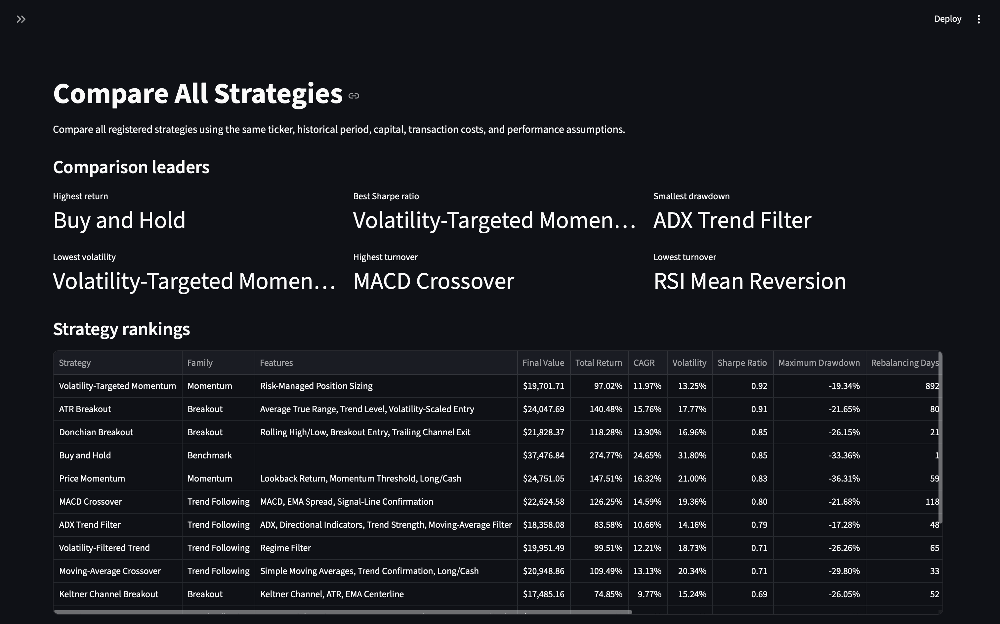
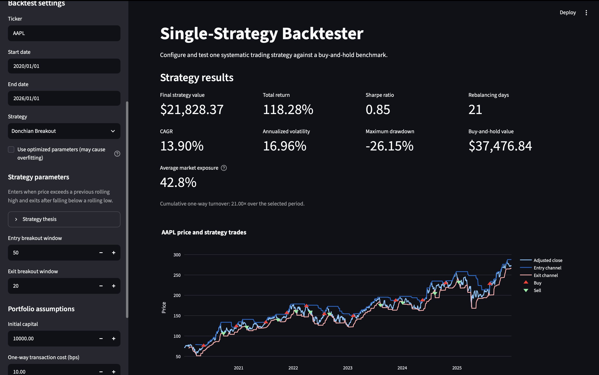
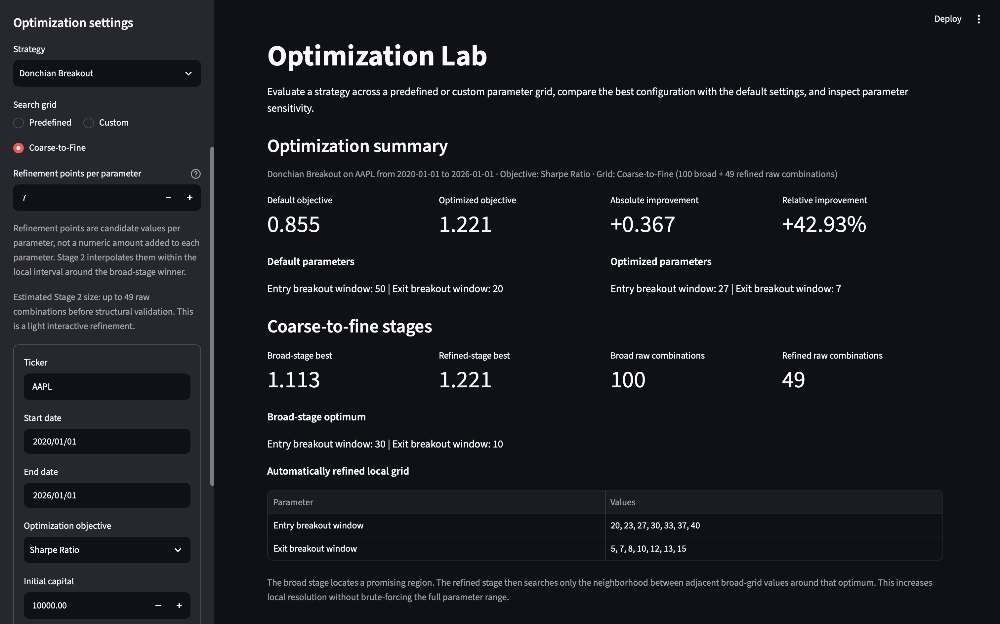
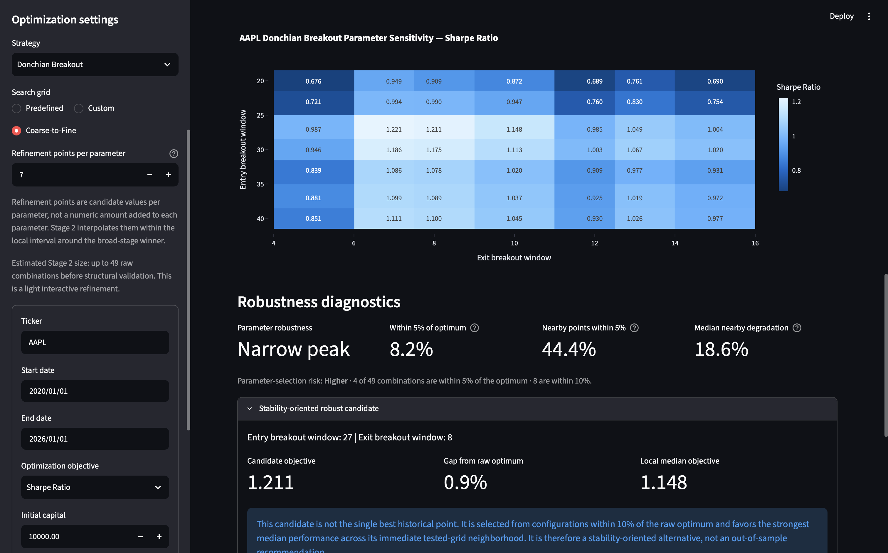
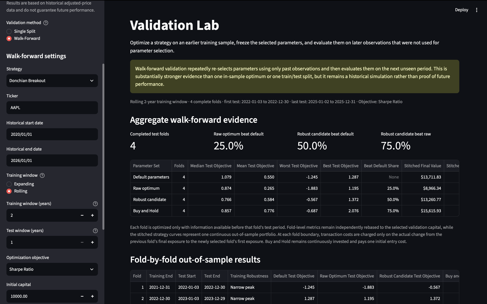
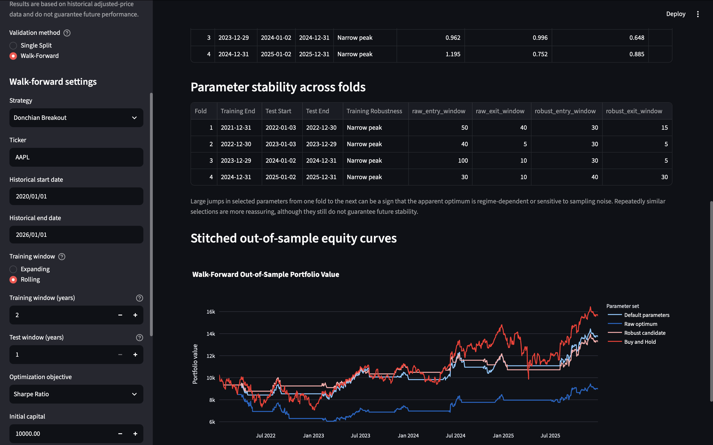

# 📈 Quant Strategy Research Platform

A quantitative research platform for implementing, backtesting, comparing, optimizing, and validating systematic trading strategies on historical equity data.

Built with **Python**, **pandas**, **NumPy**, **Plotly**, **Streamlit** and **yfinance**.

---


[](LICENSE)

[](https://quant-strategy-research-platform.streamlit.app)

> **This project is designed for quantitative strategy research and education. It is not a trading signal service, automated execution system, or source of investment recommendations.**

The platform is built around a simple idea: a strong historical backtest is only the beginning of strategy research.

A strategy may perform well because its underlying idea captured persistent market behavior, because its parameters happened to fit a particular historical period, or simply because the selected sample was favorable. The platform therefore goes beyond individual backtests by providing tools for parameter sensitivity analysis, robustness diagnostics, out-of-sample testing, and walk-forward validation.

---

## Research Workflow

The application is organized around a progressively more demanding research process:

```text
Strategy implementation
        ↓
Historical backtest
        ↓
Cross-strategy comparison
        ↓
Parameter optimization
        ↓
Robustness diagnostics
        ↓
Out-of-sample validation
        ↓
Walk-forward validation
```

Each stage answers a different question.

**Backtesting**

> How did this strategy behave historically under the selected assumptions?

**Comparison**

> How did different systematic approaches behave over the same market period?

**Optimization**

> Which tested parameters maximize the selected historical objective?

**Robustness analysis**

> Is the mathematical optimum surrounded by similarly strong parameter choices, or is it an isolated peak?

**Out-of-sample validation**

> Do parameters selected on earlier observations retain their behavior on data that was not used to select them?

**Walk-forward validation**

> Does parameter selection continue to work when the optimization and unseen-test process is repeated through time?

The platform deliberately separates these questions rather than treating the highest in-sample performance as sufficient evidence of strategy quality.

---

# Platform Preview

The screenshots below use **AAPL** over a common historical period to demonstrate the main research workflow.

They are intended to show how the application moves from strategy comparison and individual backtesting toward parameter research, robustness analysis, and repeated out-of-sample validation.

## Cross-Strategy Comparison

Compare all registered strategies under the same ticker, time period, capital, transaction-cost, and risk-free-rate assumptions.



## Single-Strategy Research

Inspect one strategy's parameters, headline metrics, market exposure, trades, and strategy-specific indicators.

The example below shows the default Donchian Breakout implementation using prior rolling High/Low channels.



## Coarse-to-Fine Optimization

Compare the default configuration with the mathematical optimum and inspect how a broad parameter search is refined locally around the most promising region.



## Parameter Sensitivity and Robustness

The optimization surface is used to investigate whether strong historical performance is concentrated around a narrow parameter peak or supported by a wider near-optimal region.



## Walk-Forward Validation

Repeated chronological training and unseen-test folds evaluate whether parameter selection remains useful outside the observations used for optimization.



## Parameter Stability and Stitched OOS Performance

Walk-forward validation also records how selected parameters change across folds and compounds the unseen test periods into continuous stitched out-of-sample research curves.



---

# Features

## Compare All Strategies

Run every registered strategy on the same ticker and historical period under common assumptions.

The comparison framework reports metrics including:

- Final portfolio value
- Total return
- CAGR
- Annualized volatility
- Sharpe ratio
- Maximum drawdown
- Rebalancing activity
- Cumulative one-way turnover
- Average market exposure
- Buy and Hold benchmark performance

Strategies can be ranked across multiple performance and risk dimensions rather than by return alone.

The comparison page can also optionally use optimized parameters. Because those parameters are selected from the same historical sample being compared, optimized comparison results are explicitly treated as **in-sample research rather than validated evidence**.

---

## Single Strategy

Study one strategy in greater detail.

The Single Strategy page provides:

- Configurable strategy parameters
- Strategy-specific indicators
- Price and signal visualizations
- Position behavior
- Strategy and Buy and Hold equity curves
- Drawdown analysis
- Performance metrics
- Rebalancing activity
- One-way turnover
- Average market exposure

An optional optimized-parameter mode can search the strategy's predefined research grid before running the backtest.

Optimized results are clearly identified as in-sample and potentially vulnerable to overfitting.

---

## Optimization Lab

The Optimization Lab studies how strategy performance changes across parameter configurations.

It supports:

- Predefined research grids
- Custom parameter grids
- Coarse-to-fine parameter search
- Multiple optimization objectives
- Ranked parameter combinations
- Two-dimensional parameter sensitivity heatmaps
- Higher-dimensional parameter sensitivity profiles
- Boundary-optimum diagnostics
- Near-optimal-region analysis
- Stability-oriented parameter selection

Supported optimization objectives include:

- Sharpe ratio
- Total return
- CAGR
- Annualized volatility
- Maximum drawdown

The platform distinguishes between the **raw optimum** and a **stability-oriented candidate**.

The raw optimum is the mathematical best tested parameter combination for the selected objective.

The stability-oriented candidate is selected from the near-optimal region using the behavior of its surrounding tested parameter neighborhood. This provides an alternative to automatically trusting a single isolated optimum.

---

# Optimization Robustness

A high-performing parameter combination is not necessarily a robust one.

The platform therefore analyzes the shape of the tested optimization surface.

Diagnostics include:

- Share of tested combinations within 5% of the optimum
- Share within 10% of the optimum
- Performance of the immediate tested-grid neighborhood
- Median nearby objective degradation
- Boundary-optimum detection
- Stability-oriented candidate selection

Optimization surfaces are summarized using descriptive labels:

- **Broad plateau**
- **Moderate plateau**
- **Narrow peak**

A broad near-optimal region can be more reassuring than an isolated optimum because small parameter changes do not immediately destroy the historical result.

These classifications are intentionally treated as **descriptive heuristics**, not statistical proof that a strategy is or is not overfit.

---

# Validation Lab

Optimization tells us what worked best on historical training data.

Validation asks the more important question:

> What happened after those parameters were selected?

The Validation Lab provides both single-split and walk-forward out-of-sample testing.

---

## Single-Split Validation

The historical sample is divided into two chronological regions:

```text
Training period
      ↓
Parameter optimization
      ↓
Parameters frozen
      ↓
Unseen test period
```

Observations before the split are used for optimization.

Observations on or after the split are reserved for out-of-sample evaluation.

The test period is not used to select the raw optimum or stability-oriented candidate.

The platform compares:

- Default parameters
- Raw training optimum
- Stability-oriented candidate
- Buy and Hold

Training and test performance are displayed separately so deterioration outside the optimization sample can be observed directly.

---

## Expanding Walk-Forward Validation

Expanding walk-forward validation repeats the optimization and unseen-test process through time while retaining all previous training history.

For example:

```text
2020–2021 → test 2022
2020–2022 → test 2023
2020–2023 → test 2024
2020–2024 → test 2025
```

Each test window remains unseen when its parameters are selected.

This evaluates whether parameter selection remains useful as more historical information becomes available.

---

## Rolling Walk-Forward Validation

Rolling validation instead keeps a fixed-length recent training window.

For example:

```text
2020–2021 → test 2022
2021–2022 → test 2023
2022–2023 → test 2024
2023–2024 → test 2025
```

Older observations eventually leave the optimization sample.

This allows the platform to investigate whether strategy behavior appears more stable when parameter selection emphasizes relatively recent market regimes.

---

## Walk-Forward Evidence

For every fold, the platform records:

- Training period
- Test period
- Training robustness
- Default test objective
- Raw-optimum test objective
- Robust-candidate test objective
- Buy and Hold test objective
- Out-of-sample degradation
- Whether optimized parameters beat the defaults
- Whether the stability-oriented candidate beat the raw optimum
- Selected parameter history

Repeated unseen periods are also summarized into aggregate walk-forward evidence.

The application builds stitched out-of-sample equity curves to show how the sequence of unseen test periods behaves as a continuous research portfolio.

Fold-level metrics remain independently rebased for comparison, while stitched strategy curves transition continuously between successive out-of-sample folds. Transaction costs at fold boundaries therefore apply to the actual change in exposure rather than unnecessarily liquidating and rebuilding an unchanged position.

Repeated out-of-sample success is stronger evidence than a single optimized historical backtest, but it still does **not** guarantee future performance.

---

# Strategy Guide

The Strategy Guide documents the ideas represented by the platform rather than treating strategies as black boxes.

Each registered strategy includes information such as:

- Strategy family
- Strategy subtype
- Signal style
- Main features
- Core idea
- Strategy thesis
- Market behavior it is designed around
- Favorable environments
- Unfavorable environments
- Main risks
- Parameter definitions
- Optimization considerations
- Validation considerations
- Related strategies

Descriptions of favorable and unfavorable environments refer to **market behavior**, not claims that a strategy will reliably outperform on a particular stock, sector, or future period.

The Strategy Guide is intended to connect the mathematical implementation with the economic intuition behind each research rule.

---

# Included Strategies

The platform currently includes 15 strategies covering several systematic research ideas.

## Trend Following

- Moving-Average Crossover
- EMA Crossover
- MACD Crossover
- ADX Trend Filter
- Volatility-Filtered Trend
- Daily and Weekly Trend Confirmation

## Breakout

- Donchian Breakout
- ATR Breakout
- Keltner Channel Breakout

## Momentum

- Price Momentum
- Volatility-Targeted Momentum

## Mean Reversion

- RSI Mean Reversion
- Bollinger-Band Mean Reversion
- Stochastic Mean Reversion
- CCI Mean Reversion

The Strategy Guide provides the detailed interpretation, parameter definitions, risks, and intended market behavior for each implementation.

---

# Why 15 Strategies?

The number of strategies is intentionally limited.

The goal of the platform is **not to maximize the size of the strategy catalog**. Instead, the included strategies are intended to represent meaningfully different systematic ideas while keeping the research environment understandable, auditable, and extensible.

Many apparently different strategies are better understood as parameter variations of the same underlying idea.

For example, separate moving-average window combinations do not need to become separate strategies. They belong inside the parameter and optimization framework.

Adding dozens of minor indicator variations would increase the feature count without necessarily increasing the research value of the project.

The included set therefore prioritizes:

- Coverage of distinct systematic ideas
- Interpretability
- Parameter research
- Robustness analysis
- Out-of-sample validation
- Code clarity
- Extensibility

The 15 included strategies should be viewed as a **curated research set and examples of the framework**, not as the limits of the platform.

---

# Adding a Custom Strategy

The strategy architecture is designed to be extensible.

A new strategy can be integrated into the existing research workflow without creating separate comparison, optimization, or validation systems.

## 1. Create a strategy module

Add a new Python file inside:

```text
strategies/
```

For example:

```text
strategies/my_strategy.py
```

A long-or-cash strategy should generate a `signal` column:

```python
import pandas as pd


def generate_my_strategy_signals(
    data: pd.DataFrame,
    window: int = 20,
) -> pd.DataFrame:
    result = data.copy()

    # Calculate indicators here.

    result["signal"] = ...

    return result
```

The signal convention is:

```text
0 = cash
1 = long
```

Strategies using continuous position sizing can additionally provide:

```python
result["target_position"]
```

The backtester prioritizes `target_position` when it is available, allowing fractional exposure rather than forcing every strategy into binary long/cash positions.

---

## 2. Register the strategy

Import and register the implementation in:

```text
strategies/__init__.py
```

The central strategy registry connects the implementation to the rest of the application.

---

## 3. Add strategy metadata

Add the strategy's metadata and parameter definitions to the central metadata registry.

Metadata powers the Strategy Guide and other research interfaces, including information such as:

- Display name
- Family
- Subtype
- Features
- Signal style
- Description
- Thesis
- Favorable environment
- Unfavorable environment
- Risks
- Parameter specifications
- Optimization guidance
- Validation guidance

Automated tests verify that registered strategies contain the required documentation fields.

---

## 4. Add an optimization grid

Define a predefined research grid for the strategy so it can participate in Optimization Lab and optimized research workflows.

Parameter grids should be broad enough to investigate meaningful behavior without creating unnecessarily large brute-force searches.

---

## 5. Run the tests

After adding a strategy:

```bash
python -m pytest
```

The existing test suite checks strategy output, registry integrity, metadata completeness, backtester compatibility, and other research assumptions.

---

# Backtesting Methodology

## Historical Data

Historical market data is downloaded using `yfinance`.

Adjusted historical prices are used so corporate actions represented by the adjusted series are reflected in the backtest.

---

## Returns

Daily simple returns are calculated from adjusted closing prices.

---

## Signal Timing and Look-Ahead Protection

Strategy indicators and signals may use information available on trading day \(t\).

The resulting desired exposure is shifted by one trading observation before portfolio returns are calculated.

Conceptually:

```text
Information available on day t
            ↓
Signal calculated on day t
            ↓
Position used on day t + 1
```

This prevents a strategy from using a closing-price signal to retroactively earn the return that produced that same closing price.

Breakout strategies may additionally use prior-period channel levels where required by their definitions.

---

## Position Model

The platform is currently long-only.

Most strategies use binary exposure:

```text
0 = cash
1 = fully invested
```

Strategies designed around risk-managed position sizing can use continuous target exposure.

Negative exposure is rejected by the backtester.

---

## Transaction Costs

Transaction costs are modeled as configurable **one-way proportional costs on changes in portfolio exposure**.

For example:

```text
0.0 → 1.0 = 1.0 one-way turnover
1.0 → 0.0 = 1.0 one-way turnover
0.4 → 0.7 = 0.3 one-way turnover
```

This allows the same transaction-cost model to support both binary and continuously sized strategies.

---

## Buy and Hold Benchmark

Buy and Hold is treated as an executable benchmark rather than a cost-free theoretical curve.

The benchmark pays one initial one-way transaction cost when its position is established and then remains invested.

---

## Average Market Exposure

Average market exposure is calculated from the realized position series.

For binary strategies, it approximately represents the proportion of the backtest spent invested.

For continuously sized strategies, it represents the average fraction of capital exposed to the asset.

This provides useful context when comparing a partially invested strategy with a 100%-exposed Buy and Hold benchmark.

---

# Performance Metrics

The platform reports several complementary performance measures.

## Total Return

Total compounded return over the complete research period.

## CAGR

Compound annual growth rate based on elapsed calendar time.

## Annualized Volatility

Daily return volatility annualized using 252 trading days.

## Sharpe Ratio

Annualized risk-adjusted return relative to the selected annual risk-free rate.

## Maximum Drawdown

Largest historical peak-to-trough decline in portfolio equity.

## Rebalancing Days

Number of trading observations on which portfolio exposure changes.

## One-Way Turnover

Cumulative absolute change in portfolio exposure.

## Average Market Exposure

Mean realized portfolio position over the research period.

No single metric is treated as sufficient evidence of strategy quality.

---

# Parameter Optimization

Parameter optimization evaluates combinations from a defined parameter grid under identical backtesting assumptions.

The selected objective determines how parameter combinations are ranked.

Higher values are preferred for:

- Sharpe ratio
- Total return
- CAGR
- Maximum drawdown, where values closer to zero are better

Lower values are preferred for:

- Annualized volatility

Optimization results are historical and in-sample unless they are subsequently evaluated through the Validation Lab.

---

# Coarse-to-Fine Search

For strategies with larger parameter spaces, the Optimization Lab supports a two-stage search.

## Stage 1 — Broad Search

A relatively sparse grid explores the wider parameter space.

## Stage 2 — Local Refinement

A denser grid is constructed around the broad-stage winner.

The refinement process interpolates candidate values inside the local neighborhood rather than simply adding a fixed numeric amount to every parameter.

Integer parameters remain integer-valued, metadata bounds are respected, and invalid parameter relationships are filtered before evaluation.

This provides greater local resolution without requiring exhaustive evaluation of every possible numeric value.

---

# Robustness vs. Optimization

The project deliberately distinguishes **optimization** from **robustness**.

Optimization asks:

> Which tested parameter combination produced the best historical objective?

Robustness asks:

> How dependent was that result on selecting exactly those parameters?

An isolated optimum surrounded by substantially worse configurations may indicate greater parameter-selection risk than a broad region of similarly strong results.

The stability-oriented candidate therefore provides an alternative research reference point, but it is not automatically assumed to be superior to the raw optimum.

Its usefulness must still be evaluated out of sample.

---

# Out-of-Sample Research Philosophy

The project intentionally avoids treating optimization as the final research result.

A parameter configuration can perform extremely well on the observations used to select it and poorly afterward.

For this reason, the research workflow separates:

```text
Parameter selection
```

from:

```text
Parameter evaluation
```

Single-split validation provides one unseen historical experiment.

Walk-forward validation repeats that experiment through time.

Neither eliminates overfitting or guarantees future performance, but both provide more meaningful evidence than reporting optimized in-sample results alone.

---

# Project Structure

A simplified view of the repository:

```text
Quant-Strategy-Research-Platform/
│
├── app.py
├── main.py
│
├── backtester.py
├── metrics.py
├── comparison.py
├── optimization.py
├── validation.py
├── plots.py
│
├── comparison_app.py
├── single_strategy_app.py
├── optimization_app.py
├── validation_app.py
├── strategy_guide_app.py
│
├── run_optimization.py
│
├── strategies/
│   ├── __init__.py
│   ├── moving_average.py
│   ├── ema_crossover.py
│   ├── rsi.py
│   ├── bollinger.py
│   ├── stochastic.py
│   ├── macd.py
│   ├── momentum.py
│   ├── donchian.py
│   ├── atr_breakout.py
│   ├── adx.py
│   ├── cci.py
│   ├── keltner.py
│   ├── volatility_filter.py
│   ├── multi_timeframe_trend.py
│   └── volatility_targeted_momentum.py
│
├── tests/
│   ├── test_backtester.py
│   ├── test_comparison.py
│   ├── test_metrics.py
│   ├── test_optimization.py
│   ├── test_optimization_robustness.py
│   ├── test_strategies.py
│   ├── test_strategy_guide_metadata.py
│   └── test_validation.py
│
├── assets/
│   ├── comparison-overview.png
│   ├── single-strategy-donchian.png
│   ├── optimization-summary.png
│   ├── optimization-robustness.png
│   ├── validation-walk-forward-overview.png
│   └── validation-walk-forward-stability.png
│
├── LICENSE
├── requirements.txt
├── .gitignore
└── README.md
```

---

# Core Modules

## `backtester.py`

Handles:

- Historical data preparation
- Daily returns
- Signal-to-position timing
- Long-only exposure
- Transaction costs
- Strategy returns
- Buy and Hold benchmark
- Equity curves
- Drawdowns

## `metrics.py`

Calculates:

- Total return
- CAGR
- Annualized volatility
- Sharpe ratio
- Maximum drawdown

## `comparison.py`

Runs registered strategies under common assumptions and builds cross-strategy rankings.

## `optimization.py`

Provides:

- Parameter-grid optimization
- Multiple objectives
- Optimization gain calculations
- Coarse-to-fine refinement
- Parameter sensitivity analysis
- Robustness diagnostics
- Stability-oriented candidate selection

## `validation.py`

Provides:

- Strict chronological train/test validation
- Frozen-parameter evaluation
- Out-of-sample degradation analysis
- Expanding walk-forward validation
- Rolling walk-forward validation
- Parameter history
- Fold-level evidence
- Continuous stitched out-of-sample equity analysis

## `strategies/__init__.py`

Acts as the central strategy registry.

It connects:

- Strategy implementations
- Default parameters
- Strategy metadata
- Parameter specifications
- Predefined optimization grids

This registry-driven structure allows the research pages to work across strategies without requiring separate application logic for every implementation.

---

# Technology Stack

The project is built primarily with:

- **Python**
- **Streamlit**
- **pandas**
- **NumPy**
- **Plotly**
- **yfinance**
- **pytest**

---

# Installation

Clone the repository:

```bash
git clone https://github.com/enesozs/Quant-Strategy-Research-Platform.git

cd Quant-Strategy-Research-Platform
```

Create a virtual environment:

```bash
python -m venv .venv
```

Activate it on macOS/Linux:

```bash
source .venv/bin/activate
```

On Windows:

```powershell
.venv\Scripts\activate
```

Install dependencies:

```bash
pip install -r requirements.txt
```

Run the application:

```bash
python -m streamlit run app.py
```

---

# Testing

Run the complete automated test suite with:

```bash
python -m pytest
```

The test suite covers areas including:

- Signal validity
- Strategy registry behavior
- Strategy metadata completeness
- Look-ahead protection
- Position timing
- Transaction costs
- Fractional exposure
- Equity compounding
- Performance metrics
- Optimization direction
- Invalid parameter combinations
- Coarse-to-fine refinement
- Optimization robustness
- Strict train/test separation
- Frozen optimized parameters
- Expanding walk-forward validation
- Rolling walk-forward validation
- Stitched out-of-sample behavior

At the time of the initial repository release, the project passes **192 automated tests**.

---

# Research Assumptions and Limitations

This platform intentionally uses a simplified research model.

Important limitations include:

## Historical performance

Historical performance does not guarantee future performance.

A successful backtest demonstrates what would have happened under the modeled assumptions, not what will happen in the future.

## Data source

Historical market data is obtained through `yfinance`.

Data availability, adjustments, corrections, and upstream provider behavior are outside the control of this project.

## Cash returns

Uninvested capital is assumed to earn zero return.

The selected risk-free rate is used for Sharpe-ratio calculations but is not credited to cash balances.

## Transaction costs

Transaction costs are modeled as proportional one-way costs on changes in exposure.

The model does not explicitly simulate:

- Bid/ask spreads
- Market impact
- Order-book liquidity
- Variable commissions
- Execution latency

## Leverage

Where a strategy permits exposure above 100%, the additional exposure represents simplified leverage.

Financing costs, borrowing constraints, margin requirements, and liquidation mechanics are not modeled.

## Short selling

The current backtester is long-only and does not support negative portfolio exposure.

## Optimization

Historical optimization can overfit.

The raw optimum should not be interpreted as the universally best parameter configuration.

## Robustness diagnostics

Broad-plateau, moderate-plateau, narrow-peak, neighborhood, and stability-oriented diagnostics are descriptive research heuristics.

They are not statistical guarantees against overfitting.

## Out-of-sample validation

Out-of-sample testing reduces direct parameter-selection bias because test observations are not used to choose the evaluated parameters.

However, researchers can still introduce bias through repeated experimentation, strategy selection, universe selection, date selection, and interpretation.

## Walk-forward validation

Walk-forward analysis provides repeated unseen historical tests and is more demanding than a single optimized backtest.

It still cannot establish future profitability.

## Portfolio scope

The current project focuses on researching one underlying asset at a time.

It is not a multi-asset portfolio-construction or portfolio-optimization engine.

## Execution

The application does not connect to a broker and does not execute trades.

---

# Intended Use

This project is intended for:

- Quantitative strategy research
- Historical experimentation
- Studying systematic trading concepts
- Parameter sensitivity analysis
- Learning about overfitting
- Comparing systematic approaches
- Practicing out-of-sample validation
- Exploring walk-forward methodology
- Extending the framework with new strategy ideas

It is **not intended to provide personalized investment advice or live trading recommendations**.

---

# Design Philosophy

The project intentionally prioritizes:

**Transparency over black-box complexity**

Strategy rules and parameter choices should be inspectable.

**Research workflow over headline backtest performance**

Optimization is treated as an intermediate step rather than the final answer.

**Validation over parameter chasing**

Unseen historical data is used to challenge conclusions formed during optimization.

**Interpretability over strategy count**

A curated set of understandable strategies is preferred to a large catalog of minor variations.

**Extensibility over exhaustiveness**

The included strategies demonstrate the framework; users can add their own research rules without redesigning the entire application.

**Honest limitations over unrealistic precision**

The platform explicitly documents assumptions that are not modeled rather than implying that a historical simulation is equivalent to real-world execution.

---

# Future Extensions

The current feature set is intentionally focused on strategy-level research.

Possible future extensions could include:

- Additional user-defined strategy families
- More advanced transaction-cost models
- Alternative market-data providers
- Additional out-of-sample research techniques
- Multi-asset research
- Portfolio-level analysis
- Short-selling support
- Financing-cost modeling

These are deliberately treated as extensions rather than requirements for the current research platform.

---

# Disclaimer

This software is provided for educational and research purposes only.

Nothing in this repository or application constitutes financial, investment, trading, legal, or tax advice.

Historical simulations, optimized parameters, robustness diagnostics, and out-of-sample results do not guarantee future performance.

Any use of the software or its outputs for real-world financial decisions is entirely at the user's own risk.