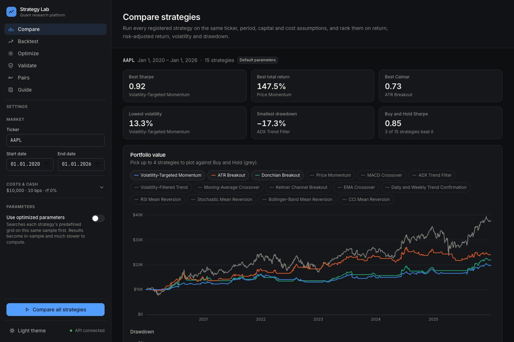
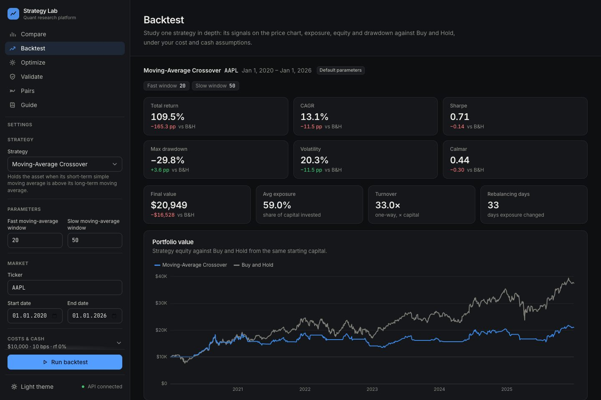
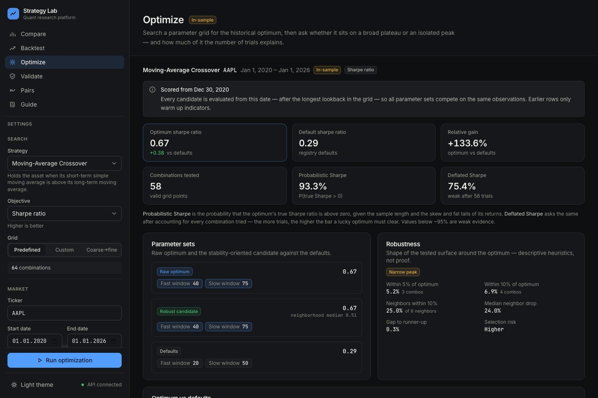
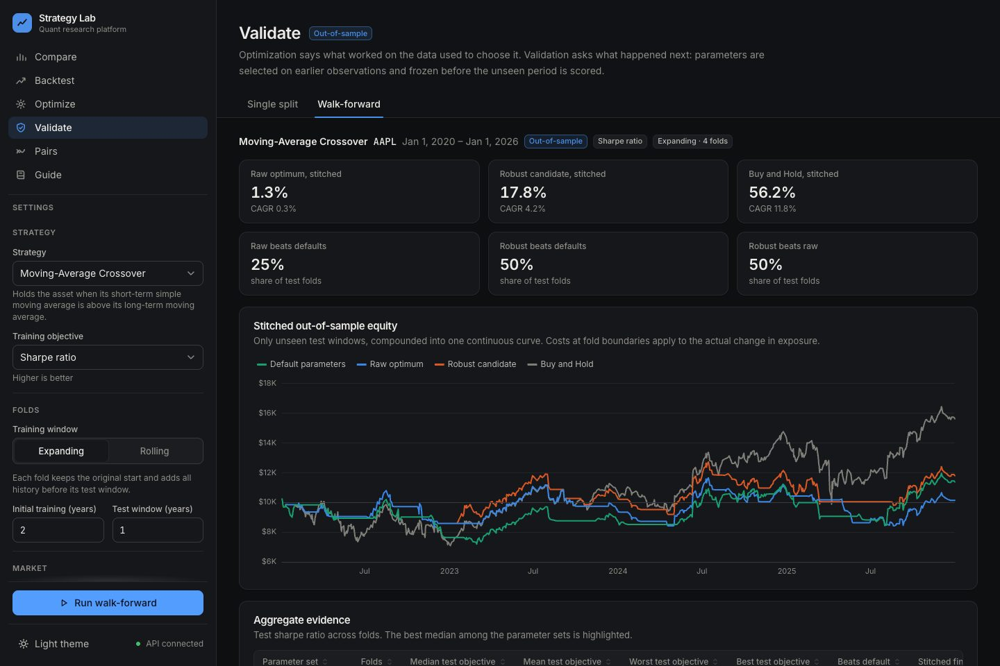
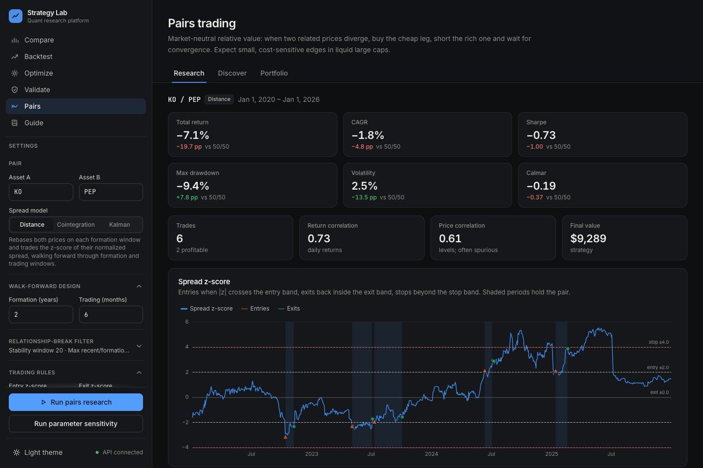
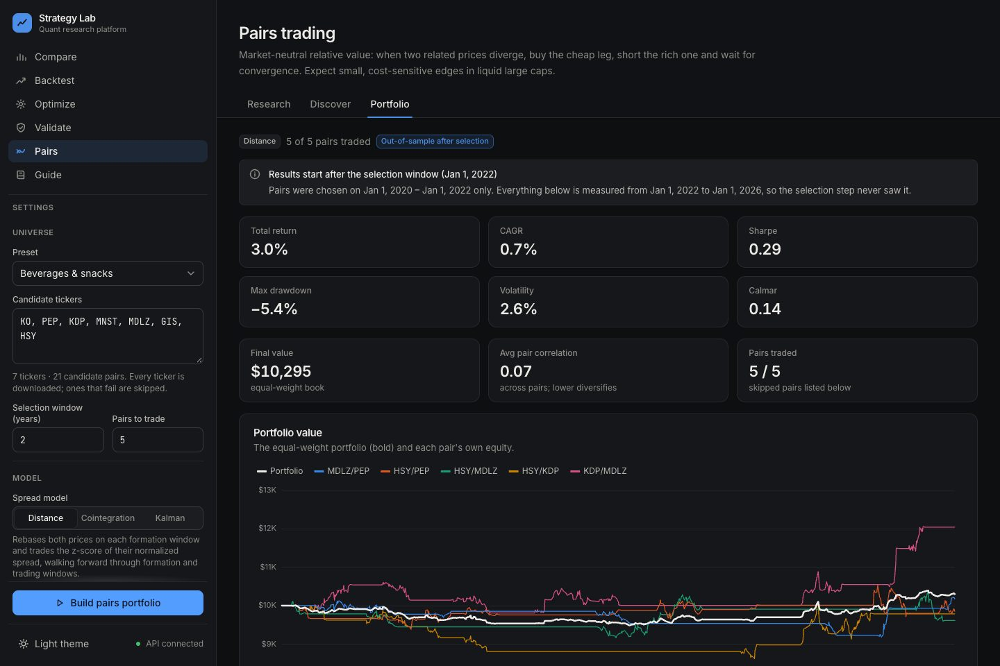
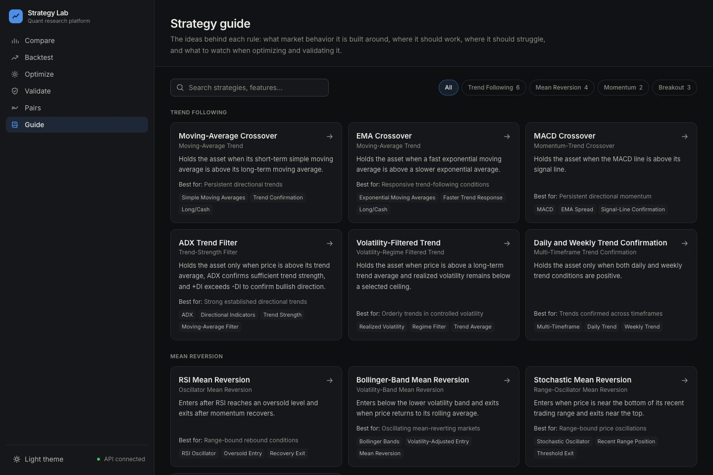

# Strategy Lab

A research platform for **backtesting, optimizing and validating systematic trading strategies**,
from single-asset trend and mean-reversion rules to market-neutral pairs trading. A tested Python
research engine is served by a FastAPI backend and explored through a React web app.


[](LICENSE)

> **Educational research tool.** Nothing here is investment advice or a trading signal. Results
> are historical simulations under stated assumptions and do not predict future performance.

The project is built around one question:

> **Did a strategy work, or did it just fit the past?**

A strong backtest can come from a real, persistent market behaviour, or from parameters that
happened to fit one sample. The platform separates the two:
- **Same rules for everyone:** every strategy and parameter set is scored on the same dates, costs
  and cash assumptions.
- **Selection is measured:** robustness diagnostics and a deflated Sharpe ratio show how much of
  an optimum the number of trials alone could explain.
- **Out-of-sample evidence:** parameters chosen on one period are frozen and tested on the next,
  once (split) or repeatedly (walk-forward).

---

## Contents

- [Application overview](#application-overview)
- Pages: [Compare & Backtest](#compare-and-backtest) · [Optimize](#optimize) ·
  [Validate](#validate) · [Pairs trading](#pairs-trading) · [Guide](#strategy-guide)
- [Included strategies](#included-strategies)
- [Backtesting methodology](#backtesting-methodology)
- [Correctness and validation](#correctness-and-validation)
- [Architecture](#architecture)
- [Technology](#technology)
- [Getting started](#getting-started)
- [API](#api)
- [Adding a strategy](#adding-a-strategy)
- [Deployment](#deployment)
- [Assumptions](#assumptions)

---

## Application overview

<p align="center">
  
</p>

Every research page shares one layout: settings in the sidebar under the navigation, headline
metrics at the top, then charts and tables explaining where the result comes from. Results stay
on screen while you change settings, with a banner when they no longer match the controls.

| Page | Research question |
|---|---|
| **Compare** | How did every strategy behave on the same ticker, period, costs and cash assumptions? |
| **Backtest** | What did one strategy do: signals on the price chart, exposure, equity and drawdown against Buy and Hold? |
| **Optimize** | Which parameters scored best in-sample, and is that optimum a broad plateau or an isolated peak? |
| **Validate** | Do parameters chosen on earlier data keep working on data they never saw? (split and walk-forward) |
| **Pairs** | Does a market-neutral spread between two related assets mean-revert profitably, and does pair *selection* work out of sample? |
| **Guide** | What is each strategy's idea, where should it work, where does it fail, and what do its parameters mean? |

---

## Compare and Backtest

<p align="center">
  
</p>

- **Compare** runs all 15 strategies on one ticker and ranks them on total return, CAGR,
  volatility, Sharpe, maximum drawdown and Calmar, with Buy and Hold ranked alongside. It also
  draws equity and drawdown for up to four strategies, a risk-versus-return scatter, and a
  drawdown ranking. Optionally, each strategy is first optimized on its predefined grid; those
  results are labelled **in-sample**.
- **Backtest** studies one strategy in depth:
  - metric tiles with the difference from Buy and Hold;
  - equity and drawdown curves;
  - the price chart with the strategy's indicators and shading while a position is held;
  - an oscillator panel for RSI, CCI, ADX or MACD with their thresholds;
  - exposure, turnover and rebalancing activity.

## Optimize

<p align="center">
  
</p>

- **Searches:** a predefined research grid, a custom grid (up to 5,000 combinations), or a
  coarse-to-fine search that refines locally around the broad optimum.
- **Objectives:** Sharpe ratio, total return, CAGR, volatility, maximum drawdown or Calmar.
- **Common burn-in.** Every candidate is scored from the same date, after the longest lookback
  in the grid. Earlier observations only warm up indicators. Without this, a 200-day window
  would spend months in cash while a 20-day one traded, which biases every comparison.
- **Probabilistic and deflated Sharpe ratio** (Bailey & López de Prado). These give the
  probability that the optimum's true Sharpe is above zero, before and after accounting for
  every combination tried. For example, the best AAPL moving-average crossover scores 93%
  before the adjustment and 75% after 58 trials, so the score reflects the search as well as
  the strategy.
- **Robustness diagnostics:** the share of combinations within 5% and 10% of the optimum,
  neighbourhood degradation, boundary optima, a plateau or peak label, and a
  **stability-oriented candidate** chosen from the near-optimal region.
- **Sensitivity:** a two-parameter heatmap with the optimum starred, and best/median profiles
  for each parameter.

## Validate

<p align="center">
  
</p>

- **Split.** The sample is divided at a date. Parameters are optimized on the training period
  only, then frozen and evaluated on the test period. Defaults, the raw optimum and the robust
  candidate are compared with Buy and Hold, with out-of-sample degradation for each.
- **Walk-forward.** The split is repeated through time:
  - expanding windows keep all history; rolling windows keep a fixed recent length;
  - each fold's test window stays unseen when its parameters are chosen;
  - fold results are stitched into one continuous out-of-sample equity curve. Positions carry
    across fold boundaries, and costs apply only to actual changes in exposure;
  - parameter history shows whether the chosen parameters stay stable from fold to fold.

## Pairs trading

<p align="center">
  
</p>

When two related prices diverge, buy the cheap leg, short the rich one, and wait for the spread
to converge. Three spread models are available:

| Model | Spread | Hedge ratio | Trades when |
|---|---|---|---|
| **Distance** (Gatev et al.) | Difference of prices normalized to each formation window | 1:1 dollars | Always |
| **Cointegration** (Engle–Granger) | OLS residual of log prices, refit each formation window | Frozen per window | Only in windows that pass cointegration, half-life and mean-crossing tests |
| **Kalman** | Innovation of a filter tracking `log A = α + β·log B` | Adaptive, locked at entry | Always (after warmup) |

All three share the same trade mechanics:
- **Rules:** entry, exit, stop and time-stop rules, with a cooldown after stops. The default exit
  is full convergence (z = 0). Trades never open beyond the stop.
- **Execution and costs:** next-day execution, proportional costs on both legs, an annual borrow
  fee on the short leg, and the cash rate earned on idle capital.
- **Trade log:** entry and exit dates, leg contributions and exit reason for every trade.

**Discover and Portfolio.** One pair's backtest mostly measures the luck of that pair. Discovery
ranks a universe of candidates, and presets cover beverages, oil majors, banks, payments,
country and sector ETFs, and precious metals.
- **No selection look-ahead:** the ranking uses the opening formation window only.
- **Multiple testing:** a Bonferroni-adjusted p-value shows how many "cointegrated" pairs could
  be chance.
- **Portfolio:** trades the top N pairs strictly after the selection window as one
  equal-weight book. This tests the *selection process* out of sample.

<p align="center">
  
</p>

**What to expect.** The engine captures an edge when one exists. On synthetic pairs with a
strongly mean-reverting spread, cointegration reaches a Sharpe ratio of about 2.0, distance
1.6–1.9 and Kalman about 1.2. On a pure random-walk spread, cointegration correctly declines to
trade. On real pairs it acts as a filter: it approves about 20% of formation windows, and the
windows it approves trade better than the ones it rejects.

## Strategy Guide

<p align="center">
  
</p>

Each strategy documents:
- its family, signal style and thesis;
- the market behaviour it is designed around;
- favourable and unfavourable environments, and its main risks;
- parameter definitions;
- optimization and validation notes.

Each detail page links straight to Backtest, Optimize and Validate.

---

## Included strategies

Fifteen strategies across four families. They were chosen to represent distinct systematic ideas
rather than to maximize the catalogue: parameter variations of one idea belong in the optimizer,
not in new strategies.

| Family | Strategies |
|---|---|
| Trend following | Moving-Average Crossover · EMA Crossover · MACD Crossover · ADX Trend Filter · Volatility-Filtered Trend · Daily and Weekly Trend Confirmation |
| Breakout | Donchian Breakout · ATR Breakout · Keltner Channel Breakout |
| Momentum | Price Momentum · Volatility-Targeted Momentum (continuous position sizing) |
| Mean reversion | RSI · Bollinger Bands · Stochastic · CCI |

---

## Backtesting methodology

- **Data:** adjusted daily prices from Yahoo Finance (`yfinance`); daily simple returns.
- **No look-ahead:** a signal computed from information on day *t* sets the position for day
  *t + 1*. Breakout channels use prior-period levels.
- **Positions:**
  - single-asset strategies are long or cash, with continuous sizing (0–150%) for
    volatility-targeted momentum;
  - pairs hold a long and a short leg with gross exposure of 100% of capital.
- **Costs:** one-way proportional costs on every change in exposure (`0.4 → 0.7` costs 0.3 of
  turnover). Buy and Hold pays one entry cost.
- **Cash and financing:**
  - idle cash earns the cash rate (by default, the risk-free rate);
  - exposure above 100% is borrowed at the cash rate plus a financing spread;
  - the short leg of a pair pays an annual borrow fee.
- **Metrics:** total return, CAGR (calendar time), volatility (×√252), Sharpe ratio (excess of
  the risk-free rate), maximum drawdown and Calmar ratio. Also turnover, rebalancing days and
  average exposure, so a partly invested strategy can be compared fairly with a fully invested
  benchmark.

---

## Correctness and validation

The test suite (250 Python tests, 17 frontend tests, all offline on synthetic data) checks:
- **Timing and costs:**
  - positions use the previous day's signal;
  - costs scale with turnover;
  - Buy and Hold pays exactly one entry cost;
  - cash interest and financing are credited and charged correctly.
- **No leakage:**
  - training and test samples are strictly separated;
  - test indicators warm up on history only;
  - walk-forward stitching equals one continuous backtest when every fold uses the same
    parameters;
  - discovery ranks only on the selection window.
- **Optimization:**
  - objective directions are correct;
  - every candidate is scored on the same window;
  - robustness and degradation stay stable for optima near zero;
  - tie-breaking is deterministic;
  - the deflated Sharpe ratio falls as trials increase.
- **Pairs:**
  - stateful entry/exit/stop/cooldown rules;
  - trade attribution, including exit costs and exit reasons;
  - the Kalman z-score is calibrated to the realised spread;
  - the filter uses only past information.
- **API:** every endpoint, request validation, error codes and NaN-free JSON.
- **Browser:** every page and its main run was driven with Playwright in both themes at desktop
  and phone widths, with no console errors.

---

## Architecture

Three layers, each depending only on the one below:

```
web/        React + TypeScript UI ──── fetch /api/* ────▶  api/  FastAPI
                                                              │  validation + serialisation, no math
                                                              ▼
            backtester · metrics · strategies/ · optimization · validation · comparison · pairs_trading_*
                                         research engine (pandas / NumPy / statsmodels, no web code)
```

```text
02-strategy-backtester/
├── backtester.py              # signal timing, costs, cash/financing, warm-window backtests
├── metrics.py                 # performance metrics, Calmar, probabilistic and deflated Sharpe
├── strategies/                # 15 strategy modules + registry (metadata, defaults, grids)
├── optimization.py            # grids, coarse-to-fine, burn-in, sensitivity, robustness
├── validation.py              # split and walk-forward validation, stitched OOS equity
├── comparison.py              # all strategies under common assumptions, rankings
├── pairs_trading_core.py      # pair data, stateful signals, two-leg backtester, trade log
├── pairs_trading_distance.py · pairs_trading_cointegration.py · pairs_trading_dynamic.py
├── pairs_trading_discovery.py # universe ranking on the opening window, presets
├── pairs_trading_portfolio.py # out-of-sample multi-pair portfolio
├── pairs_trading_sensitivity.py
├── api/                       # FastAPI app; request/response contract in api/CONTRACT.md
├── web/                       # React app: pages/, components/, charts/, lib/format.ts
├── tests/                     # pytest suite, including tests/test_api.py
├── *_app.py, app.py           # legacy Streamlit interface (kept as a reference)
├── docs/screenshots/
├── AGENTS.md                  # conventions, invariants and roadmap for contributors
└── Makefile
```

---

## Technology

| Layer | Stack |
|---|---|
| Research engine | Python 3.13, pandas, NumPy, statsmodels, SciPy |
| API | FastAPI, Pydantic v2 (OpenAPI docs at `/docs`) |
| Frontend | React 19, TypeScript 6, Vite 8, Tailwind CSS v4, TanStack Query, React Router |
| Charts | Apache ECharts 6 with a palette validated for light and dark themes |
| Market data | yfinance (cached in-process per ticker and date range) |
| Quality | pytest, vitest, oxlint, Prettier, Playwright |
| Legacy UI | Streamlit + Plotly |

---

## Getting started

Requirements: **Python 3.12–3.13** and **Node 20+**.

```bash
git clone https://github.com/enesozs/Quant-Strategy-Research-Platform.git
cd Quant-Strategy-Research-Platform

make install   # .venv with the Python requirements, then the web app's npm packages
make dev       # API on :8020 (auto-reload) + web app on :5190
```

Open **http://localhost:5190**, and press **Ctrl+C** to stop both servers. The ports differ from
the other QuantProjects (8000/5173, 8010/5180), so they can all run side by side.

| Command | What it does |
|---|---|
| `make serve` | Build the UI and serve everything from FastAPI on http://localhost:8020 |
| `make test` | Python and frontend unit tests (offline) |
| `make lint` | Ruff on the API and its tests |
| `make build` | Production build of the frontend into `web/dist` |
| `make streamlit` | The legacy Streamlit interface |

The first run of a ticker downloads its history from Yahoo Finance, which needs internet access.
Repeat runs are served from the cache.

---

## Deployment

The web app runs as **one container**: the React build served by the FastAPI API.

```bash
docker build -t strategy-lab .
docker run -p 8020:8020 strategy-lab      # http://localhost:8020
```

`render.yaml` deploys it on [Render](https://render.com) as a Docker web service (New →
Blueprint → this repository), with a health check on `/api/health` and automatic deploys on
every push. The image installs only the web app's dependencies (`requirements-api.txt`) and
listens on `$PORT`.

---

## API

Eleven JSON endpoints under `/api`. Interactive documentation is at
**http://localhost:8020/docs**, and the request/response shapes are specified in
[`api/CONTRACT.md`](api/CONTRACT.md).

| Endpoint | Purpose |
|---|---|
| `GET /health` · `GET /meta` | Status · strategies, parameters, grids, objectives, pairs methods, universe presets |
| `POST /backtest` | One strategy: metrics, equity, drawdown, indicators |
| `POST /compare` | Every strategy under common assumptions, with rankings |
| `POST /optimize` | Grid or coarse-to-fine search, robustness, heatmap, profiles, deflated Sharpe |
| `POST /validate/split` · `/validate/walk-forward` | Out-of-sample validation |
| `POST /pairs/research` · `/pairs/sensitivity` | One pair under a spread model · local parameter sensitivity |
| `POST /pairs/discover` · `/pairs/portfolio` | Universe ranking · out-of-sample multi-pair portfolio |

---

## Adding a strategy

1. **Implement it** in `strategies/my_strategy.py` as a function that takes the price DataFrame
   and parameters and adds a `signal` column (0 = cash, 1 = long). It can optionally add a
   `target_position` column for fractional exposure.
2. **Register it** in `strategies/__init__.py` with its metadata (family, thesis, environments,
   risks, parameter specs) and a predefined optimization grid. Integer parameters are window
   lengths; the burn-in relies on that.
3. **Run `make test`.** The suite checks registry integrity, metadata completeness and
   backtester compatibility.

The web app picks the strategy up automatically: forms, the Guide, Compare, Optimize and Validate
are all generated from the registry.

---

## Assumptions

- **Execution:** daily closing prices with next-day execution and proportional costs; cash,
  financing and borrow rates are constant over each backtest.
- **Data:** adjusted daily prices from Yahoo Finance; ticker universes and pair presets are
  chosen by the user.
- **Scope:** single-asset strategies trade one asset at a time and pairs trade two legs per
  pair; multi-asset rotation is on the roadmap in [AGENTS.md](AGENTS.md).
- **Robustness labels** (plateau, peak, robust candidate) describe the optimization surface, and
  every result is a historical simulation rather than a prediction.

---

## Legacy interface

The original Streamlit interface (`app.py` and the `*_app.py` pages) is kept as a reference and
still runs with `make streamlit`. New features land in the web app only.

## License

[MIT](LICENSE)
